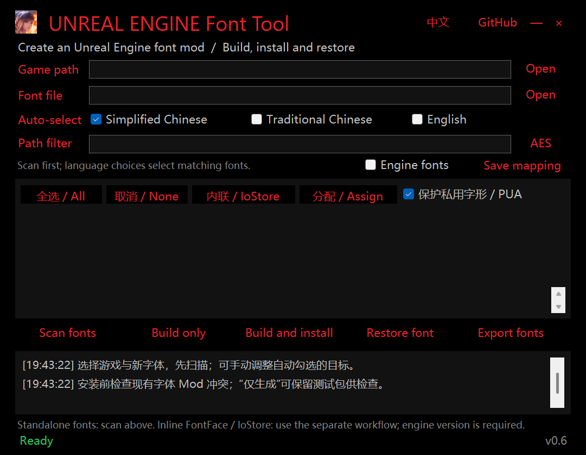

# UNREAL ENGINE Font Tool

[简体中文](README.md) · [Download / Releases](https://github.com/jakeouyang/UEFontTool/releases) · [Changelog](CHANGELOG.md)

A Windows desktop tool to detect fonts in Unreal Engine games and build, install and restore font mods. Written in C# / .NET 8 / WinForms, with Chinese and English interfaces. A full Unreal Editor installation is not required.



## Download

Download `UEFontTool-vVERSION-win-x64.zip` from **Releases**, extract the complete archive, and run `UEFontTool.exe`. Keep the adjacent `tools` folder. The .NET runtime is included; Python is not required. GitHub's Source code archives are not runnable builds.

## Quick start (v0.8)

1. Choose the game root or its exact `Content/Paks` directory, and a replacement TTF/OTF font.
2. Select the **game's display language** and click **Detect fonts**. The tool inspects standalone fonts and supported embedded resources together.
3. Review **Recommended targets**, language hints and **Replacement font**. Every target uses the font chosen above unless given an override.
4. Exit the game normally and click **Build and install**. Required files are generated, verified and installed together into `Paks/~mods`; no manual PAK/UTOC/UCAS copying is needed.
5. Check menus and subtitles in game. To undo, exit the game, select the same game in the tool and click **Restore fonts**.

**Already have a font mod?** Installation checks packages editing the same resources. Review the conflict list, then cancel or explicitly choose **Suspend conflicts and continue**. Matching `.pak/.utoc/.ucas` groups are backed up together and brought back by Restore. Unreadable existing packages block installation. Checks cover Paks subdirectories and root-level `_P` packages; root patches may be official files, so cancel if unsure they are mods.

**Unsure about language?** Select a row to see localization-path, family-marker or known-profile evidence. These hints do not establish runtime use. Unmarked fonts are never selected automatically; review **Language unconfirmed**. **Preview original** shows actual glyph coverage and supports export. Missing sample characters appear as boxes rather than a silent system-font fallback.

**Different fonts for different targets?** Check targets and use **More → Choose another font for checked items**. **Use default for checked items** removes the override. Select all/Clear affect only the current filter; hidden selections are counted below. Engine fallback fonts are excluded from recommendations.

**Advanced controls?** **Settings** contains masked AES input, engine-version overrides and mod names. The unchecked-by-default **Allow missing custom characters** option is beside **Game language** in the main window. Version detection is automatic where possible. **More** offers Build only, output folder, detection details and Expert tools. The older dedicated expert builder still builds only; use the default interface for automated installation/restoration.

Language switching, GitHub and Settings sit in the title bar immediately before the minimize/maximize/close controls. The UEF icon is shared by the executable, window title and expert tools, without a duplicate content heading. The black title bar retains minimize, maximize/restore, close, dragging and edge resizing. Action buttons have no borders; hover and keyboard focus change their text color. Inputs and buttons share a height. Drag the list/details divider to resize the information area; long details wrap and scroll. On smaller windows, content scrolls while build/install/restore actions remain visible.

## Fonts and containers

Standalone `.ttf/.otf/.ufont` targets normally generate a PAK. FontFace resources in IoStore require resource rewriting and matching `.pak/.utoc/.ucas` files. Packaging follows the selected targets; successfully extracting a font does not mean a PAK-only override will work. Output basenames must end in `_P`, default `zz_UEFontTool_P`, covering naming requirements such as CodeVein2's.

Pinned retoc source with this project's UCAS partition reader and UAssetAPI 1.1.0 perform IoStore → legacy → FontFace rewrite → IoStore without Unreal Editor. Font array lengths and export sizes/offsets are updated. Fonts are hash-checked, containers verified and converted back for export-byte comparison. Mixed builds merge loose targets into the companion PAK while retaining container metadata. The PBZ profile also creates valid matching IoStore companions for standalone-only font mods to meet its loading requirements.

v0.8 fixes FFRS producing only a PAK: some sampled FontFace resources originally reference external `.ufont` data. Replacing that byte file alone did not override this loading path. The tool now recognizes the observed UE5.6 unversioned layout, checks coverage against the original external font, sets Inline loading policy and embeds the replacement before generating the complete container group. Conversion is limited to validated layouts; other native layouts are not guessed.

Private-use character loss is blocked by default. These characters may be button icons or other custom symbols. Choose a more complete replacement, uncheck the target, or explicitly check **Allow missing custom characters** beside **Game language**, without Expert mode. **Allowing loss does not add missing glyphs or preserve original icon outlines.** Missing codepoints are shown and recorded. Ordinary missing CJK characters are reported, not merged.

## Tested scope and limitations

| Sample / scenario | Verified result |
| --- | --- |
| FFRS / UE5.6 | Five recommended Simplified Chinese targets; external FontFace converted to Inline; full container roundtrip, installation and restoration passed; user confirmed in-game replacement on 2026-10-29 |
| CodeVein2 / UE5.4 | Three recommended Simplified Chinese targets in an `_P` group; existing Chinese-font mod detected and suspended; roundtrip, installation and restoration passed; user confirmed in-game replacement |
| PBZ (Phantom Blade Zero) / UE5.7 | Read 66 UCAS partitions directly; extracted 142 font-related assets with zero failures; recognized 54 supported external and 7 inline FontFaces; container build and roundtrip verified, runtime appearance unconfirmed |
| Black Myth: Wukong | Custom footer/entry adapter; uncompressed output verified in game on the tested local Steam build |
| DragonSword: Awakening | Observed v101 AES/masked-index adapter; 54 original plus six standard mod PAKs scanned; one target extracted, built and read back; runtime appearance unconfirmed |
| Hogwarts Legacy / Lords of the Fallen | Standalone PAK extraction, build and readback verified; this does not establish support for all IoStore resources |
| Standard / encrypted PAKs | Standalone fonts supported; a matching AES key may still require a game-specific format adapter |

Original mods in both test games were restored and checked against SHA-256 snapshots after testing. Runtime confirmations cover the sampled builds and selected fonts, not every menu, subtitle, icon or game version.

**Inline support is neither universal nor FFRS-only.** Existing inline FontFace rewriting was verified in CodeVein2 (UE5.4); external-to-inline conversion targets the observed FFRS UE5.6 and PBZ UE5.7 layouts, including their ANSI/UTF-16 source filenames. Other games must have parseable resources, a supported native layout and a verified container roundtrip. The engine-version dropdown lists parser parameters, not certified support for every font format in those versions.

Supported layouts include bounded terminal SFNT arrays, the observed four-byte zero suffix, and the UE5.6/5.7 external FontFace layouts above. External `.ubulk/.uptnl` rewriting, arbitrary native serialization layouts, offline atlases, TTC replacement, automatic icon merging and missing-glyph generation remain unsupported. **Universal UE4/UE5 compatibility is not guaranteed.**

Details include static imports, font classes and selected/candidate containers. Static references do not prove runtime widget use; retoc's selected source does not guarantee an extra loader's mount order. Composite properties are exported when version/mappings permit; the expert window accepts a matching `.usmap`. Unresolved character ranges and fallback relationships still need review. Default embedded extraction filters paths containing `Font`; full-game UI reference traversal is not implemented.

## Output, backups and restoration

The adjacent `data/` folder holds settings, analyses, builds, installation records and backups. Guided builds live under `data/guided-output/`; installable files are in each build's `ReadyToInstall/`. `result.json` records the game, targets and artifact hashes. Detailed conversion/missing-character reports are in that build's `build/manifest.json` or the standalone build manifest.

Restore checks surviving tool files and suspended backups before making changes. Manually removed tool files do not prevent rebuilding or restoring suspended mods. Surviving files with changed hashes block the operation; files are not blindly overwritten or removed by name. Missing or changed suspended backups still prevent restoration. Updating an owned installation retains suspended-mod records. Failed operations attempt rollback. **Keep the original tool directory's `data/` folder when updating or moving the application**, otherwise reliable restoration is unavailable. Legacy expert-mode standalone PAK installations can still be restored.

Operation failures show their cause and full details in the main information area and More → Detection details. The latest error is saved to `data/last-error.txt` with key-shaped data redacted. Local paths remain; review before sharing.

## Troubleshooting

### Does missing-character protection require Expert mode?

No. The information area identifies the target, private-use character count and codepoints. Uncheck that target, choose a different replacement for it, or explicitly check Allow missing custom characters beside Game language and retry. Private-use characters may be icons or custom glyphs; allowing loss does not generate or merge glyphs. For FFRS, use the default guided container workflow; the legacy expert PAK scanner does not replace it.

### AES input / DragonSword V0 or magic errors

Paste 64 hexadecimal digits (optional `0x`) or a Base64-encoded 32-byte key in **Settings → AES key**. Input is masked, session-only and not saved to configuration or logs. Apply an empty field to clear it.

The old repak `trying version V0 failed` message is a final generic format probe failure, not the game's actual version. The observed DragonSword archives use custom version 101 with additional index, string and entry masking after AES decryption. A dedicated reader is required. It checks keys against the primary index SHA-1 and validates index ranges and extraction, but not every game variant is supported.

### Do signed games require Signature Bypass?

Signature checking and font storage are separate. Copying an original `.sig` does not sign a changed mod. Wukong output is converted to the observed runtime layout; the tested local build requires neither `-fileopenlog` (not implemented in that shipping build) nor a third-party bypass. Other games' loading, signature and anti-cheat requirements need individual verification. This project includes no bypass DLLs and does not modify game executables.

### Oodle extraction fails

Oodle is not redistributed. If required, provide a legally obtained compatible `tools/oo2core_9_win64.dll`. Index scanning may succeed while extraction still needs it. Do not commit this DLL, AES keys or game assets.

## Build from source and release automation

Requires Windows x64, .NET 8 SDK, PowerShell 7, Rust/rustup and Visual C++ build tools. The build pins Rust 1.90.0; release users do not need development tools.

```powershell
git clone git@github.com:jakeouyang/UEFontTool.git
cd UEFontTool
./scripts/Build.ps1
```

The script acquires and verifies pinned dependencies, builds a self-contained app, runs tests, and packages a file allowlist as ZIP plus SHA-256. Local `data/`, keys, game files, Oodle and experiments are excluded.

```powershell
./scripts/Get-Dependencies.ps1
./scripts/Get-Retoc.ps1
dotnet build UEFontTool/UEFontTool.csproj -c Release
dotnet UEFontTool/bin/Release/net8.0-windows/UEFontTool.dll --self-test test-results.txt
```

Automated tests use synthetic archives, system fonts and test-only keys; no game is needed. Main pushes, PRs and manual Actions runs build/test and upload artifacts. A `v*` tag matching the project version, such as `v0.8.8`, publishes to GitHub Releases. The workflow uses `GITHUB_TOKEN`; personal tokens and SSH private keys do not belong in source control.

## Command line

```text
UEFontTool.exe scan "GAME_DIR" "scan.json"
UEFontTool.exe build "GAME_DIR" "FONT.ttf" "build.json" "Game/Content/Fonts/Font.ufont"
UEFontTool.exe export "GAME_DIR" "OUTPUT_DIR" [targets...]
UEFontTool.exe scan-cooked "GAME_DIR" UE5_6 "EMPTY_ANALYSIS_DIR" Font
UEFontTool.exe build-guided "cooked-plan.json" "EMPTY_OUTPUT_DIR"
UEFontTool.exe conflicts-guided "GAME_DIR" "BUILD_DIR"
UEFontTool.exe install-guided "GAME_DIR" "BUILD_DIR"
UEFontTool.exe restore-guided "GAME_DIR"
```

See [cooked-plan.example.json](docs/cooked-plan.example.json). `Replacements` maps resources to fonts. `build-guided` distinguishes `.uasset` and standalone targets; `build-cooked` and `build-mapped` remain available for dedicated advanced builds. Add `--suspend-conflicts` to `install-guided` only when suspension is intended. Use `restore` for legacy standalone installations.

CLI variables are `UEFONTTOOL_AES_KEY` and optional `UEFONTTOOL_USMAP`. IoStore currently uses the first AES key without GUID-to-key routing. Generic PAK operations pass keys to the local repak subprocess; software with process-inspection access may read them. Configuration and reports contain local paths; redact before sharing.

## License and contributions

Project code uses [MIT](LICENSE). Dependencies and licenses are listed in [THIRD_PARTY.md](THIRD_PARTY.md). Game assets and fonts belong to their respective owners and are not distributed here. Issues should include game version, container format, redacted errors and reproduction steps, without keys, credentials, original game assets or personal directory information.
