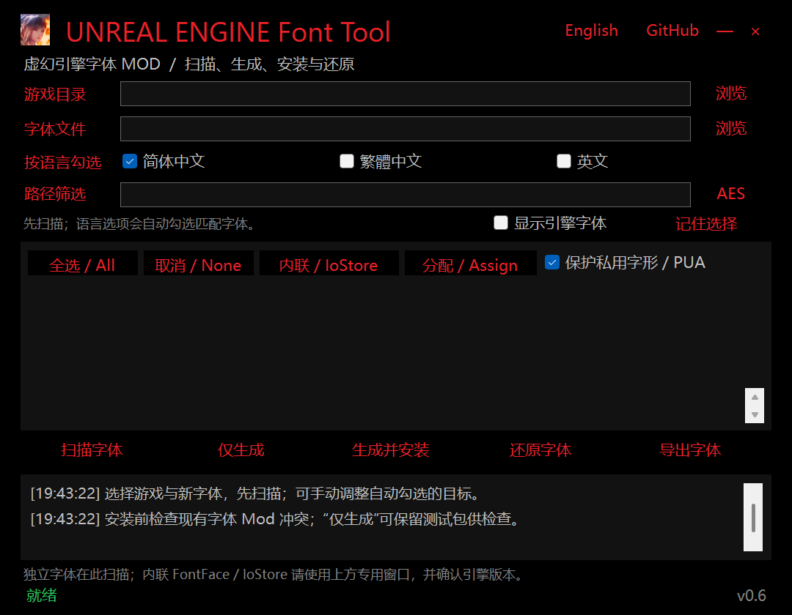

# UNREAL ENGINE Font Tool

[English](README.en.md) · [下载 / Releases](https://github.com/jakeouyang/UEFontTool/releases) · [更新记录](CHANGELOG.md)

Windows 桌面工具：检测虚幻引擎游戏中的字体，查看语言提示，生成、安装及还原字体 MOD。采用 C# / .NET 8 / WinForms，支持中文和英文界面，不需要完整 Unreal Editor。



## 下载运行

从 **Releases** 下载 `UEFontTool-v版本-win-x64.zip`，完整解压后运行 `UEFontTool.exe`。保留同目录的 `tools` 文件夹。自带 .NET 运行时，不需要 Python。GitHub 自动生成的 Source code 压缩包是源码，不是可直接运行的软件。

## 快速开始（v0.8）

1. 选择游戏根目录或准确的 `Content/Paks` 目录，以及想使用的新 TTF/OTF 字体。
2. 选择**游戏显示语言**，点击 **检测字体**。工具自动检查普通字体和当前支持的封装资源，不需要自行判断是否内联。
3. 查看 **推荐替换项**，检查原字体名称、语言提示和 **将使用的新字体**。默认使用顶部新字体，无需逐项设置。
4. 正常退出游戏，点击 **生成并安装**。工具生成并校验所需文件，按整组自动安装到游戏 `Paks/~mods`；无需自己复制 PAK、UTOC、UCAS。
5. 启动游戏检查菜单和字幕。需要撤销时，正常退出游戏，在工具中选择同一游戏，点击 **还原字体**。

**已有字体 MOD？** 安装前检查修改相同资源的包。发现冲突时，显示文件清单；可以取消，也可以明确选择“暂存冲突 MOD 并继续”。冲突包的同名 `.pak/.utoc/.ucas` 会整组备份，点击还原时恢复。无法读取已有包时停止安装。检查覆盖 Paks 子目录及根目录 `_P` 包；根目录补丁可能属于官方文件，无法自动判断时请取消，不要盲目暂存。

**不知道字体属于什么语言？** 点击一行，查看本地化目录、系列标记或已知游戏配置等识别依据。这些提示不保证运行时用途。无可靠标记的项目不会自动勾选，切换“语言待确认”查看。**预览原字体**显示真实字形覆盖，并可导出；缺少的示例字显示为方框，不用系统字体冒充。

**不同项目使用不同字体？** 在列表勾选目标，使用 **更多操作 → 为勾选项单独选新字体**。选择“勾选项恢复默认字体”可取消单独设置。全选、清空只影响当前筛选结果，隐藏的选择会在下方计数。Engine 回退字体默认不推荐。

**高级参数在哪里？** 顶部 **设置**中可直接粘贴 AES、手动选择引擎版本及设置输出名称。“允许缺少特殊字符”位于主界面 **游戏语言**右侧，默认不勾选。默认自动检测版本；无法确定时才需手选。**更多操作**提供仅生成、打开输出目录、检测详情和专家工具。专家窗口的旧式专用构建仍只生成；自动安装和还原使用默认新手界面。

标题栏在最小化、最大化和关闭控件左侧并排提供语言切换、GitHub 和设置；图标位于软件标题左侧，内容区不再重复大标题。窗口使用全黑标题栏，保留最小化、最大化/还原、关闭、拖动及边缘缩放。输入框与按钮统一高度；列表与字体详情之间的分隔条可拖动，长信息可换行和滚动。窗口较小时，内容区支持滚动，底部生成、安装和还原操作保持可见。

## 字体与容器的处理

独立 `.ttf/.otf/.ufont` 通常生成 PAK；IoStore 内的 FontFace 需要修改资源并生成同名 `.pak/.utoc/.ucas`。软件按实际目标选择，不应因为能解包就假设只需要 PAK。输出名称必须以 `_P` 结尾，默认 `zz_UEFontTool_P`，照顾 CodeVein2 等加载命名规则。

使用固定版本 retoc v0.1.5 与 UAssetAPI 1.1.0 完成 IoStore → legacy → FontFace 重写 → IoStore，无需 UE 编辑器。修改字体数组长度、导出长度和偏移，重读字体检查 SHA-256，校验容器后再反向提取比对导出字节。混合目标会合并独立字体到配套 PAK，保留容器元数据。

v0.8 修复 FFRS 只输出 PAK 的问题：该样本的部分 FontFace 原本引用外部 `.ufont`，仅换字节文件不足以覆盖这条加载路径。现在识别实测 UE5.6 未版本化布局，读取原始外部字体进行覆盖分析，设置 Inline 加载策略并把新字体写入 FontFace，再生成完整容器组。只对已验证布局转换，其他布局不会猜测改写。

默认保护新字体缺少的私用区字符。它们可能是按键图标，也可能是自定义字符。构建因此停止时，可以换覆盖更完整的字体、取消对应目标，或勾选 **游戏语言**右侧的 **允许缺少特殊字符**后重试，无需专家模式。**允许缺失不会补字，也不会保留原图标轮廓**。缺失码点记录在提示和构建清单中；普通 CJK 缺字会报告，不自动合并。

## 实测范围与限制

| 样本 / 场景 | 已验证结果 |
| --- | --- |
| FFRS / UE5.6 | 5 个简体推荐目标生成整组容器；外部 FontFace 转 Inline；容器往返、安装与还原通过；用户于 2026-10-29 确认游戏内字体生效 |
| CodeVein2 / UE5.4 | 3 个简体推荐目标生成 `_P` 容器组；检测并暂存已有中文字体 MOD；往返、安装、还原通过；用户确认游戏内生效 |
| 黑神话：悟空 | 自定义 PAK footer/条目布局适配，输出未压缩条目，经当前本机 Steam 样本游戏内验证 |
| DragonSword: Awakening | 观测到的 v101 AES/混淆索引适配；54 个原版及 6 个标准 Mod PAK 扫描通过，单目标提取、构建和回读通过；未确认游戏内外观 |
| 霍格沃茨之遗、堕落之主 | 已验证 PAK 内独立字体提取、构建及回读；不等于所有 IoStore 资源均可替换 |
| 标准 PAK、加密 PAK | 支持独立字体，正确 AES 之外仍可能需要游戏格式适配 |

测试安装后，已用 SHA-256 核对两款测试游戏的原有 MOD 恢复。游戏内确认仅覆盖此次样本和选中字体，不代表全部菜单、字幕、图标和游戏版本都已覆盖。

**内联支持并非覆盖所有游戏，也不只限 FFRS。** 已有内联 FontFace 的替换在 CodeVein2（UE5.4）实测；外部 FontFace 转内联目前仅适配 FFRS 所用的特定 UE5.6 布局。其他游戏须同时满足资源可解析、FontFace 布局受支持及容器往返校验通过。引擎版本下拉框只是解析参数列表，不代表各版本的全部字体格式都已兼容。

当前支持有边界的终端 SFNT 字节数组，包括实测四字节零尾部，以及上述 UE5.6 外部 FontFace 布局。尚不支持外部 `.ubulk/.uptnl` 重写、任意原生序列化布局、离线字体图集、TTC 替换、自动图标合并和补字，**不能保证所有 UE4/UE5 游戏兼容**。

详情包含静态导入引用、字体类、来源容器及候选版本；静态引用不证明某个运行时菜单实际使用该字体。retoc 选择的资源也不保证与额外加载器的挂载顺序相同。复合字体属性仅在版本/映射允许解析时导出；专家窗口可选择匹配的 `.usmap`。未解析的字符范围与回退关系仍需人工确认。默认只分析路径包含 `Font` 的封装资源，尚未遍历全游戏 UI 引用。

## 输出、备份和还原

程序旁的 `data/` 保存设置、分析、构建、安装记录及备份。默认流程输出位于 `data/guided-output/`，可安装文件在构建目录的 `ReadyToInstall/` 中；`result.json` 记录游戏、目标及文件 SHA-256。更详细的转换、缺字报告在同次构建的 `build/manifest.json` 或独立字体构建清单中。

还原前会检查仍存在的本工具文件和冲突备份的哈希。本工具文件被手动移除后，可以重新生成或还原此前暂存的 MOD；仍存在但被外部修改的文件会阻止操作，不按名字盲目覆盖或删除。冲突备份缺失或被修改时仍会停止还原。安装更新保留先前暂存的 MOD 记录，操作失败时尝试回滚。**请保留原工具目录中的 `data/`，不要只搬走 EXE**，否则无法可靠还原。专家模式的旧版独立 PAK 安装记录仍可还原。

操作失败时，主信息区会直接显示原因与完整详情，“更多操作 → 查看检测详情”也可查看。最近一次错误保存在 `data/last-error.txt`，密钥形态的数据会脱敏；报告仍含本机路径，分享前请检查。

## 常见问题

### 缺少特殊字符必须去专家模式吗？

不需要。信息区会显示目标字体、缺少的私用区字符数量和码点。可取消该目标、为它换用另一字体，或在“游戏语言”右侧勾选“允许缺少特殊字符”后重试。私用区字符可能是图标或自定义字；允许缺失不会自动补字或合并原字形。FFRS 请使用默认新手流程生成完整容器组，专家模式的旧 PAK 扫描窗口不能替代此流程。

### AES 怎么输入？DragonSword 为什么仍报 V0 / magic 错误？

在 **设置 → AES 密钥**粘贴 64 位十六进制（可带 `0x`）或表示 32 字节的 Base64。输入默认遮蔽，仅本次会话使用，不保存到配置或日志；应用空输入可清除。

旧版 repak 最后打印的 `trying version V0 failed` 是通用格式探测失败，不代表游戏一定是 V0。DragonSword 样本使用自定义版本 101，AES 解密后还有索引、字符串和条目混淆，需要专用读取器。适配器用原版主索引 SHA-1 检查密钥，校验索引范围和提取结果；并未实现所有游戏变体。

### 使用签名的游戏需要 Signature Bypass 吗？

签名检查与字体存储格式是两层问题。复制官方 `.sig` 不能给新 MOD 签名。悟空输出自动转换为实测运行时布局，当前本机版本无需 `-fileopenlog`（该发行版不实现此参数）或第三方绕过。其他游戏的加载、签名和反作弊要求需分别确认；本项目不包含绕过 DLL，也不修改游戏可执行文件。

### Oodle 字体无法提取？

程序不分发 Oodle。需要时自行提供合法来源、架构匹配的 `tools/oo2core_9_win64.dll`。索引可扫描不代表实际提取无需此库。不要将该 DLL、AES 或游戏资源提交到仓库。

## 从源码构建与自动发布

需要 Windows x64、.NET 8 SDK、PowerShell 7。

```powershell
git clone git@github.com:jakeouyang/UEFontTool.git
cd UEFontTool
./scripts/Build.ps1
```

脚本下载并校验固定版本依赖，构建自包含程序，执行测试，再按文件白名单输出 ZIP 和 SHA-256；不包含本机 `data/`、密钥、游戏资源、Oodle 或实验目录。

```powershell
./scripts/Get-Dependencies.ps1
./scripts/Get-Retoc.ps1
dotnet build UEFontTool/UEFontTool.csproj -c Release
dotnet UEFontTool/bin/Release/net8.0-windows/UEFontTool.dll --self-test test-results.txt
```

自动测试使用合成包、系统字体和测试密钥，不需要游戏。`main` 推送、PR 或手动 Actions 会构建、测试并上传产物；推送与项目版本一致的 `v*` 标签（如 `v0.8.6`）会发布至 GitHub Releases。流水线使用 `GITHUB_TOKEN`，不需要提交个人令牌或 SSH 私钥。

## 命令行

```text
UEFontTool.exe scan "GAME_DIR" "scan.json"
UEFontTool.exe build "GAME_DIR" "FONT.ttf" "build.json" "Game/Content/Fonts/Font.ufont"
UEFontTool.exe export "GAME_DIR" "OUTPUT_DIR" [targets...]
UEFontTool.exe scan-cooked "GAME_DIR" UE5_6 "EMPTY_ANALYSIS_DIR" Font
UEFontTool.exe build-guided "cooked-plan.json" "EMPTY_OUTPUT_DIR"
UEFontTool.exe conflicts-guided "GAME_DIR" "BUILD_DIR"
UEFontTool.exe install-guided "GAME_DIR" "BUILD_DIR"
UEFontTool.exe restore-guided "GAME_DIR"
```

计划格式见 [cooked-plan.example.json](docs/cooked-plan.example.json)，`Replacements` 逐资源指定字体。`build-guided` 自动区分 `.uasset` 和独立字体；`build-cooked`、`build-mapped` 供单独高级构建。仅在明确需要暂存冲突时向 `install-guided` 添加 `--suspend-conflicts`。旧版独立安装使用 `restore`。

CLI 通过进程环境变量 `UEFONTTOOL_AES_KEY`、可选 `UEFONTTOOL_USMAP` 传入参数。IoStore 目前只使用第一个 AES，没有按 GUID 匹配多密钥。通用 PAK 操作把密钥传给本机 repak 子进程，有进程检查权限的软件可能读取它。配置和报告包含本机路径，分享前请脱敏。

## 许可与贡献

项目采用 [MIT](LICENSE)，第三方依赖与许可见 [THIRD_PARTY.md](THIRD_PARTY.md)。游戏资源和字体版权归各自权利人，不随项目分发。Issue 请附游戏版本、容器格式、脱敏错误及复现步骤，不要上传 AES、凭据、原始游戏资源或个人目录信息。
